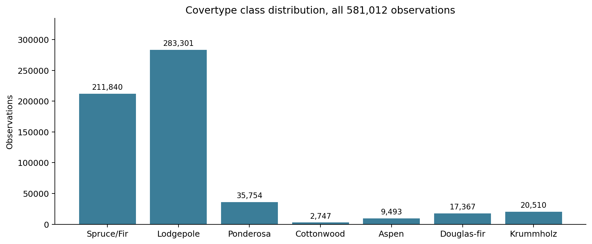
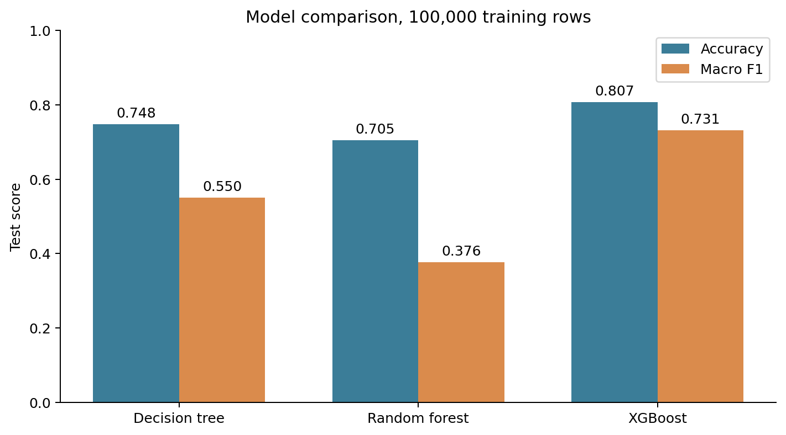
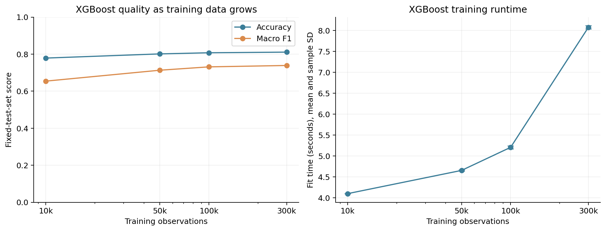
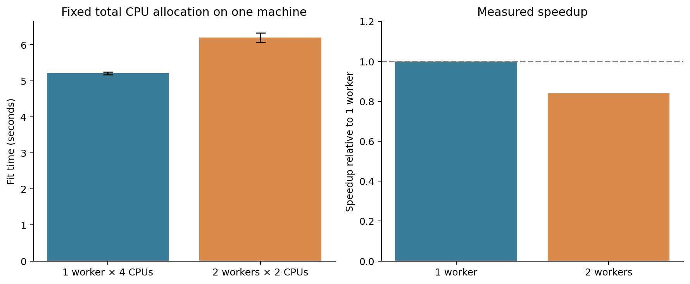
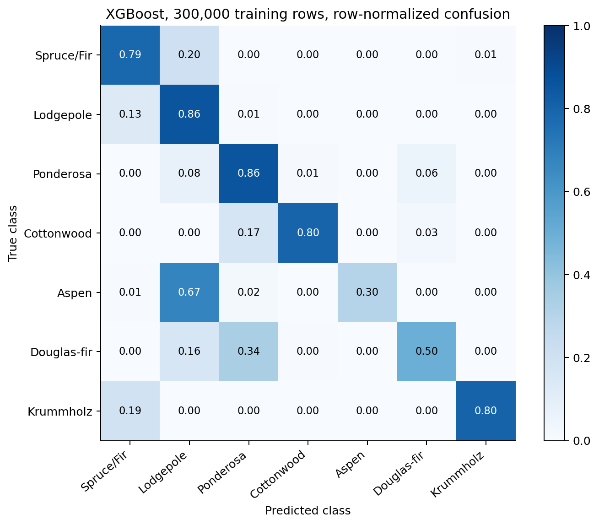
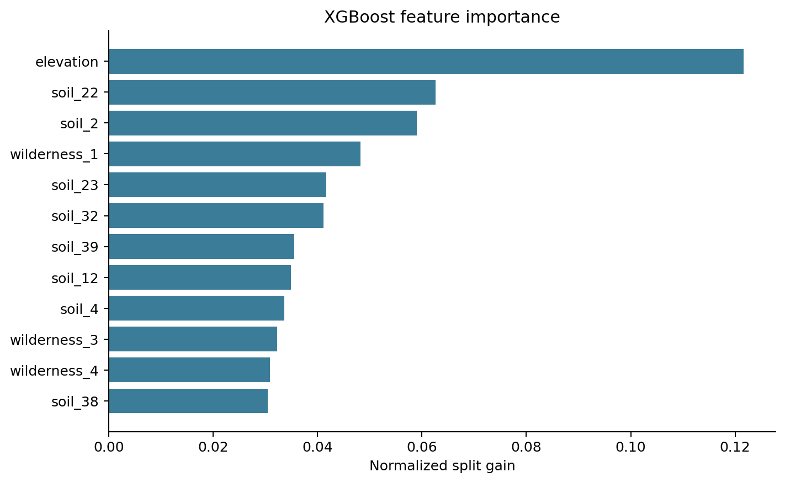

# 基于 Spark 与 XGBoost 的森林覆盖类型分类及性能分析

## 设计信息

设计课题为基于 Spark 与 XGBoost 的森林覆盖类型分类及性能分析。项目采用 Python 实现，使用 CPU 完成实验。专业班级、姓名、学号、指导教师及实际参与成员由提交者填写，本文未代填个人信息。

## 摘要

本项目基于 XGBoost 可扩展树提升方法，构建从数据下载、质量检查、Spark 特征处理、模型训练到评价及模型保存的完整实验流程。使用 UCI Covertype 的 581012 条真实观测，固定 116,203 条分层测试数据，对比决策树、随机森林和 XGBoost，并研究训练样本量及 XGBoost 工作进程数的影响。最大训练规模为 300,000，对应 XGBoost 准确率为 81.0848%，宏平均 F1 为 0.7387。所有正式实验均运行真实 PySpark 模型，XGBoost 训练日志确认使用 CPU。两工作进程在本机上的实测加速比为 0.840，反映出该规模下通信与调度成本的影响。

## 背景 目的与意义

森林覆盖类型分类根据海拔、坡度、水文距离、光照、土壤及荒野区等信息识别七种覆盖类型，可作为生态数据分析和资源调查的教学案例。该数据集类别分布不均衡，因此同时报告准确率、宏平均 F1、加权 F1 和混淆矩阵。宏平均 F1 为各类等权平均，可以暴露少数类别识别不足。

本项目对应课程中的 Spark 机器学习流水线、决策树与随机森林、可扩展机器学习和大数据处理。Spark 并行读取与处理表格数据，XGBoost 通过官方 xgboost.spark 接口执行训练。当前实验采用单机 local[4]，数据存于本地 Parquet。原论文第 6.1 节介绍了 Hadoop 等运行环境，当前本机实验未部署 HDFS 或 YARN。

## 技术要求与研究方案

实验要求全流程可在 CPU 上运行，使用官方公开数据及 XGBoost 官方接口，提供固定的数据划分、原始日志和逐条预测。模型对比使用同一份 100,000 条训练数据。规模实验使用 10,000, 50,000, 100,000, 300,000 条嵌套训练子集，测试数据始终一致。并行实验在 100,000 条训练数据上比较一工作进程和两工作进程，固定总 CPU 配额为四个核心。

## 方法设计与工作原理

整体流程依次为下载和校验压缩包、检查 54 个特征及七类标签、建立固定分层划分、保存 Parquet、Spark VectorAssembler 组装特征、模型拟合、测试集预测、指标重算、模型保存和重新加载验证。

XGBoost 是梯度提升决策树模型，逐轮增加树以降低损失，并利用正则化控制复杂度。其可扩展实现支持稀疏数据处理、并行训练及直方图分裂搜索。本项目采用官方 SparkXGBClassifier，hist 树构建方法、100 轮提升、最大深度 6、学习率 0.1，subsample 和 colsample_bytree 均为 1。每次训练的 objective 在官方接口中自动设为 multi:softprob，num_class 为 7。

Spark 决策树最大深度为 8，随机森林采用 80 棵树、最大深度 8，二者 maxBins 为 32。随机种子均为 2026。这些参数在正式实验前固定，测试集未参与超参数搜索或早停。各模型参数未按等计算预算调优，结果只反映本次给定配置的表现。

## 数据集与预处理

原始数据来自 UCI Covertype，下载压缩包、原始 gzip、数据说明、处理后的 Parquet、样本 ID 和校验值全部保存在 data。原始 gzip 的 SHA-256 已与 scikit-learn 发布的 Covertype 校验值一致，完整数据为 581012 行、55 列，其中 54 列为特征、最后一列为原始 1 至 7 标签。训练标签转换为 0 至 6。数据无缺失值，四个荒野区及四十个土壤指示变量分别满足 one-hot 约束。[UCI 数据集](https://doi.org/10.24432/C50K5N)

54 个特征包括 10 个地形和距离数值特征、4 个荒野区指示变量与 40 个土壤类别指示变量。树模型保留原始数值尺度。随机种子为 2026，分层保留 20% 作为固定测试集，其余作为训练池。各训练子集按类别比例选取，并检查小子集完全包含于大子集，训练与测试的 row_id 无交集。标签只作为监督目标与评价依据，没有加入特征列表。

| 原始类别 | 名称 | 全量样本数 | 占比 |
|---|---|---:|---:|
| 1 | Spruce/Fir | 211,840 | 36.46% |
| 2 | Lodgepole Pine | 283,301 | 48.76% |
| 3 | Ponderosa Pine | 35,754 | 6.15% |
| 4 | Cottonwood/Willow | 2,747 | 0.47% |
| 5 | Aspen | 9,493 | 1.63% |
| 6 | Douglas-fir | 17,367 | 2.99% |
| 7 | Krummholz | 20,510 | 3.53% |

## 平台与实现

实验平台为 macOS-27.0-arm64-arm-64bit，Python 3.12.4，Java 环境为 openjdk version "17.0.13" 2024-10-15 LTS，PySpark 3.5.5，XGBoost 2.1.4。依赖版本及完整安装清单保存在 requirements.txt、requirements-lock.txt 和实验 manifest.json。

所有业务代码位于 src/forest_project 和 scripts。训练采用四核本地 Spark，driver 内存上限为 4 GB。VectorAssembler 处理后将训练集和测试集分成四个 Spark 分区并物化缓存。一工作进程的 XGBoost 每任务分配四个 CPU，两工作进程每任务分配两个 CPU，训练日志记录 nthread、CPU 设备及实际 rank。Spark barrier 任务实际启动了两个 XGBoost 工作进程。

每组配置重复两次，随机种子相同，用于描述计时波动，不代表两次独立的训练测试划分。各次运行启动独立 Python 进程与 Spark JVM。training_seconds 计量 fit 调用，包含 XGBoost 训练内部的重分区、Arrow 数据转换与进程通信。preprocessing_seconds 计量 Spark 读取、特征组装、重分区、缓存及标签检查。prediction_seconds 包含 transform 的真实执行及将预测收集到 Python。wall_seconds 还包含进程与 Spark 启动、结果写入，以及首轮模型保存验证。

每组第一次运行保存完整 PipelineModel。XGBoost 另外保存 booster.json，便于独立加载。保存后对固定样本重新预测并逐项比较，独立预测入口还会在全部测试数据上验证。第二次运行保留预测及指标，用于重复计时。

## 模型效果对比

三种模型使用相同的 100,000 条训练数据和固定测试集。时间为两次运行的均值及样本标准差，单位为秒。

| 模型 | 准确率 | 宏平均 F1 | 加权 F1 | 训练耗时 | 预测及收集耗时 |
|---|---:|---:|---:|---:|---:|
| 决策树 | 0.7475 | 0.5504 | 0.7332 | 1.209 ± 0.128 | 0.457 ± 0.026 |
| 随机森林 | 0.7046 | 0.3763 | 0.6797 | 4.073 ± 0.003 | 0.934 ± 0.138 |
| XGBoost | 0.8074 | 0.7312 | 0.8037 | 5.206 ± 0.040 | 0.754 ± 0.019 |

当前配置下 XGBoost 的准确率及宏平均 F1 更高。随机森林的宏平均 F1 较低，说明该浅树、随机特征抽样配置对少数类别的识别不足。由于各模型的超参数及训练预算不同，本次对比不能外推为模型的一般排名。

## 数据规模实验

| 训练样本量 | 准确率 | 宏平均 F1 | XGBoost 训练耗时 |
|---:|---:|---:|---:|
| 10,000 | 0.7787 | 0.6542 | 4.098 ± 0.004 |
| 50,000 | 0.8012 | 0.7131 | 4.654 ± 0.013 |
| 100,000 | 0.8074 | 0.7312 | 5.206 ± 0.040 |
| 300,000 | 0.8108 | 0.7387 | 8.079 ± 0.042 |

数据规模增加时，本次模型的预测指标总体改善，训练耗时增加。由于模型固定为 100 轮、深度 6，规模增加后的指标改善逐渐减小。数据量变化与模型容量共同影响效果，增加训练数据不保证无限改善。

## 并行配置实验

| 配置 | 总 CPU 配额 | 训练耗时均值 | 准确率均值 | 宏平均 F1 均值 |
|---|---:|---:|---:|---:|
| 一工作进程，每任务四 CPU | 4 | 5.206 | 0.8074 | 0.7312 |
| 两工作进程，每任务两 CPU | 4 | 6.196 | 0.8063 | 0.7306 |

加速比定义为一工作进程耗时除以两工作进程耗时，本次为 0.840。该结果未显示两进程加速。总 CPU 预算固定，新增工作进程会产生数据切分、通信和同步成本，单机 10 万训练样本下这些成本可能超过收益。两进程的训练分区与分位数近似结果也可能带来微小预测差异。这里验证的是同一台电脑的多进程训练，不能用来证明跨机器扩展性。两次计时不足以对细小差别作显著性推断。

## 错误分析与特征解释

以下为预先约定的最大训练规模 XGBoost 模型的按真实类别归一化混淆矩阵。

混淆矩阵应按类别检查召回情况，避免只看多数类别主导的总体准确率。特征图展示按分裂增益归一化的模型重要性，可解释模型如何使用海拔、距离、土壤等变量，但不构成生态因果关系的证据。

## 验证与结果可追溯性

数据检查覆盖完整行列数、有限数值、七类标签、类别指示变量、训练测试隔离、嵌套样本关系和文件校验值。每次模型拟合均保存训练参数、输入哈希、Spark 版本、运行日志、Spark event log、逐条测试预测和混淆矩阵。

结果审计对全部 14 次正式实验重新比对固定测试 ID 和标签，从逐条预测重算准确率、宏平均与加权 F1，并重算七类混淆矩阵。训练日志核实 CPU 及两进程 rank，保存模型的运行完成了重新加载验证。详细证据位于 audit.json、results/data_verification.json 和每次运行目录。

## 与原论文的关系及局限

项目使用 Chen 与 Guestrin 在 KDD 2016 论文中提出的 XGBoost 方法，参考官方 v2.1.4 PySpark 示例建立课程实验。原论文的 benchmark 包括 Allstate、HIGGS、排序和点击数据，当前 Covertype 分类为自选应用数据，Spark/XGBoost 版本也经过更新。因此，这里完成的是基于原方法和官方实现的应用实验，原论文的数值与集群加速结果没有在本机重建。[XGBoost 原论文](https://arxiv.org/abs/1603.02754)

581012 条记录适合中等规模本地实验，最大训练子集为 30 万条。它能够展示批处理、分区、缓存、模型及数据规模对比，多机或海量数据性能需要更大资源的独立实验。当前是按行随机分层划分，同一区域的相似地形可能同时进入训练和测试，结果不能直接代表未知地理区域的泛化能力。实验没有进行超参数搜索，模型质量仍可能通过后续独立验证集调优改善。

## 结论

完成了使用 Python、真实 Spark 和官方 XGBoost 接口的森林覆盖类型分类项目。给定参数下，最大规模 XGBoost 达到 81.0848% 准确率及 0.7387 宏平均 F1。数据规模实验反映了训练时间与效果的变化，单机并行实验观察到额外工作进程的开销。全部数据、代码、模型、逐条预测、运行命令和日志均保存在项目目录，支持从头复跑及独立模型预测。

## 参考文献

1. Tianqi Chen and Carlos Guestrin. XGBoost A Scalable Tree Boosting System. KDD, 2016. DOI 10.1145/2939672.2939785。
2. UCI Machine Learning Repository. Covertype. DOI 10.24432/C50K5N。
3. XGBoost 官方 v2.1.4 PySpark 示例及文档，已保存至 references。[官方项目](https://github.com/dmlc/xgboost/tree/v2.1.4)
4. Apache Spark 3.5.5 机器学习分类与回归文档。[官方文档](https://spark.apache.org/docs/3.5.5/ml-classification-regression.html)

## 附录与成员贡献

配置位于 configs/experiment.json，完整复跑入口为 bash scripts/reproduce.sh。独立训练和预测见 README.md。summary.csv 为结果汇总，manifest.json 为命令与环境记录。各运行目录包含模型、预测、指标、特征重要性及日志。

实际参与成员应按各自完成的数据处理、模型实现、实验分析、报告和复核工作填写贡献及自评分。个人信息、成员贡献和分数由提交者确认，当前未代填。
